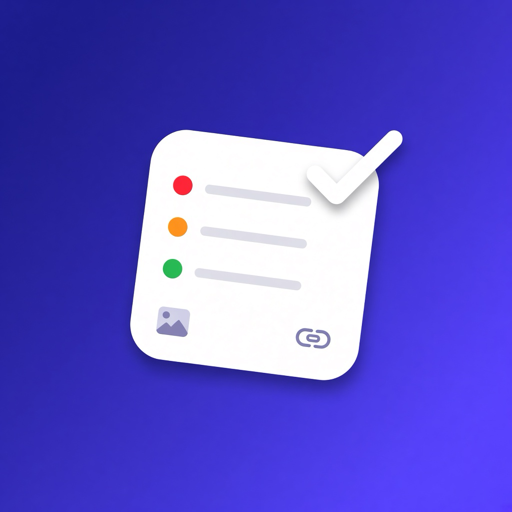
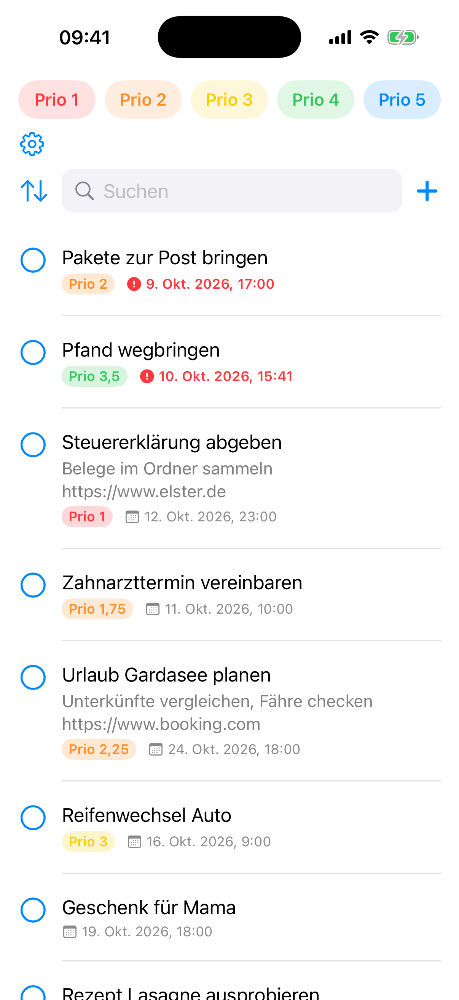
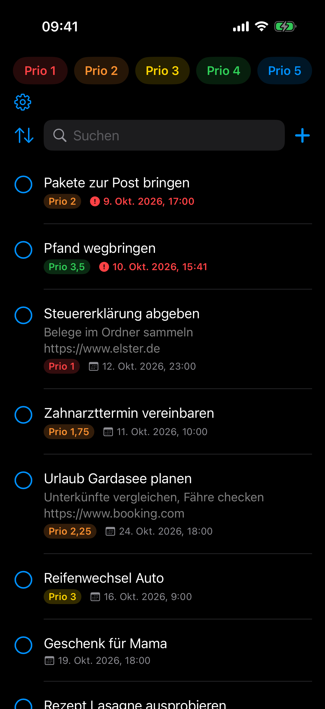
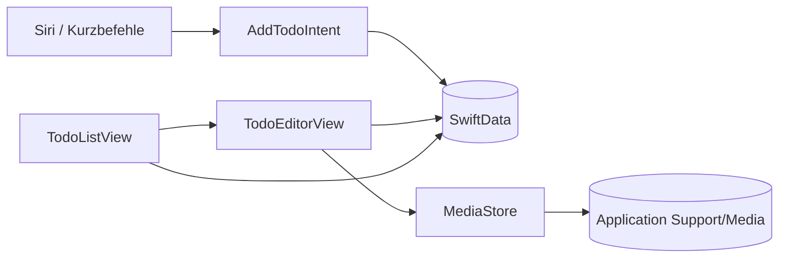

<div align="center">



# TodoMaster

**Alles, was zu tun ist. An einem Ort. Nur auf deinem iPhone.**

Schluss mit „ich schick mir das mal eben selbst auf WhatsApp“.
TodoMaster sammelt Aufgaben, Links, Fotos und Videos in einer schnellen, nativen iPhone-App
und hört auf Siri.


[**IPA herunterladen**](https://github.com/PrevosHD/TodoMaster/releases/latest) · [Features](#features) · [Siri](#siri) · [Selbst bauen](#selbst-bauen)

<br>


&nbsp;&nbsp;&nbsp;


</div>

---

## Features

### Zwei Arten von Todos

| | **ExpressTodo** | **ExtendedTodo** |
|---|---|---|
| Wofür | Schnell was notieren | Alles mit Kontext |
| Inhalt | Ein Satz | Titel, Details, Links, Fotos, Videos |
| Upgrade | **Erweitern** macht daraus eine ExtendedTodo | – |

### Prioritäten, die nicht nur 1 bis 5 können

- Schieberegler von **1** (wichtigste) bis **5** (unwichtigste) in **Viertelschritten**, also auch `2,25` oder `1,75`.
- **X** links daneben heißt: keine Priorität. Priorität ist immer optional.
- Farbige Filter-Chips oben: ein Tipp filtert, nochmal tippen zeigt wieder alles.

| Chip | Farbe | Enthält Werte |
|:---:|:---:|:---:|
| Prio 1 | Rot | 1,00 – 1,49 |
| Prio 2 | Orange | 1,50 – 2,49 |
| Prio 3 | Gelb | 2,50 – 3,49 |
| Prio 4 | Grün | 3,50 – 4,49 |
| Prio 5 | Blau | 4,50 – 5,00 |

### Liste

- **Suche** über Titel und Details.
- **Sortierung:** Neueste · Älteste · Priorität 1 zuerst · Priorität 5 zuerst · Bevorstehende (nach Fälligkeitsdatum).
- **Erledigt bis:** optionales Datum mit Uhrzeit.
- **Fällig = rot und oben:** Sobald der Zeitpunkt erreicht ist, wird das Datum rot und die Todo rutscht über alle anderen, die am längsten fällige zuerst. Abschaltbar in den Einstellungen.
- **Abhaken** per Kreis. Erledigte bleiben sichtbar, ausgegraut, immer unten.
- **Wischen** löscht, **Tippen** öffnet den Editor.

### Mitteilungen

- Zur Fälligkeit kommt eine **Mitteilung** mit Titel und Details, auch wenn die App geschlossen ist.
- Erledigt, gelöscht oder verschoben? Die Mitteilung wird automatisch abgesagt oder neu geplant.
- Alles lokal über iOS, ohne Server. Die Erlaubnis fragt die App beim ersten Datum.

### Medien

- Mehrere Fotos und Videos pro Todo, direkt aus der Mediathek.
- Sauberes 3er-Raster, quadratisch zugeschnitten, egal ob Hoch- oder Querformat.
- Antippen öffnet das Foto groß oder spielt das Video ab.
- Links in den Details werden automatisch erkannt und sind antippbar.

### Sonst noch

- Hell, Dunkel oder wie das System.
- Tastatur verschwindet beim Tippen daneben oder beim Scrollen.
- Komplett deutsch.

---

## Siri

Neue Todos, ohne die App zu öffnen:

> **„Hey Siri, neue TodoMaster“**
> *Siri:* „Wie lautet der Titel?“
> **„Müll rausbringen“**
> *Siri:* „„Müll rausbringen“ steht in TodoMaster.“

Die Todo landet als ExpressTodo ohne Priorität und ohne Datum in der Liste.

Weitere Sätze: „Neue Todo in TodoMaster“, „Neue Aufgabe in TodoMaster“, „Neuer Eintrag in TodoMaster“, „TodoMaster neue Todo“.
Siri versteht die App auch als **To-Do-Master**, **To Do Master** und **MasterTodo**.

> [!NOTE]
> Siri lernt die Sätze nach dem ersten Start der App. Das kann ein paar Minuten dauern.
> Die Siri-Sprache muss Deutsch sein.

---

## Datenschutz

**Alles bleibt auf dem Gerät.** Kein Konto, kein Server, keine Cloud, kein Tracking, keine Werbung, keine Pakete von Drittanbietern.

- Todos liegen in **SwiftData** im App-Container.
- Fotos und Videos liegen als Dateien in `Application Support/Media`, nicht in der Datenbank.
- Für Fotos und Videos nutzt die App den System-Picker. Sie bekommt nur die Medien, die du auswählst, und keinen Zugriff auf die ganze Mediathek.
- Mitteilungen sind lokal geplant. Es gibt keine Push-Server.

---

## Installieren

### IPA (Sideloading)

1. Lade `TodoMaster-…-unsigned.ipa` aus dem [neuesten Release](https://github.com/PrevosHD/TodoMaster/releases/latest).
2. Installiere es mit [AltStore](https://altstore.io) oder [Sideloadly](https://sideloadly.io). Die Tools signieren die App mit deiner eigenen Apple-ID.

> [!IMPORTANT]
> Das IPA ist absichtlich **unsigniert**. Ohne Signatur lässt es sich nicht einfach per AirDrop installieren.

### Selbst bauen

Voraussetzungen: Mac mit **Xcode 16** oder neuer, iPhone mit **iOS 17.1** oder neuer.

```bash
git clone https://github.com/PrevosHD/TodoMaster.git
cd TodoMaster
open TodoMaster.xcodeproj
```

1. In Xcode unter **Signing & Capabilities** dein eigenes Team eintragen.
2. Falls nötig, die Bundle-ID `com.nando.todomaster` ändern.
3. iPhone wählen und **⌘R** drücken.

Es gibt keine Swift-Packages und keine CocoaPods. Klonen und bauen reicht.

<details>
<summary><b>Unsigniertes IPA selbst erzeugen</b></summary>

```bash
xcodebuild -project TodoMaster.xcodeproj -scheme TodoMaster \
  -configuration Release -destination 'generic/platform=iOS' \
  -archivePath build/TodoMaster.xcarchive archive \
  CODE_SIGNING_ALLOWED=NO CODE_SIGNING_REQUIRED=NO CODE_SIGN_IDENTITY=""

mkdir -p build/Payload
cp -R build/TodoMaster.xcarchive/Products/Applications/TodoMaster.app build/Payload/
(cd build && zip -qry TodoMaster-unsigned.ipa Payload)
```

</details>

<details>
<summary><b>Screenshots mit Beispieldaten</b></summary>

Debug-Builds legen beim Start mit dem Argument `-demoData` Beispiel-Todos an, aber nur, wenn die Liste leer ist. Im Release-Build ist das nicht enthalten.

```bash
xcrun simctl launch booted com.nando.todomaster -demoData
```

</details>

---

## Aufbau



| Datei | Aufgabe |
|---|---|
| `TodoMasterApp.swift` | Einstieg, Erscheinungsbild, Tastatur-Verhalten |
| `TodoListView.swift` | Prio-Chips, Suche, Sortierung, Liste |
| `TodoRowView.swift` | Eine Zeile mit Prio, Datum und Medien-Zählern |
| `TodoEditorView.swift` | Express- und Extended-Editor |
| `PrioritySlider.swift` | Regler 1–5 in Viertelschritten plus X |
| `Todo.swift` | SwiftData-Modelle `Todo` und `MediaAttachment` |
| `TodoSort.swift` | Sortierung, Fällige oben, Erledigte immer unten |
| `NotificationScheduler.swift` | Mitteilungen zur Fälligkeit planen und abgleichen |
| `DueDate.swift` | Fälligkeit, Uhrzeit-Vorschlag, „ist fällig“ |
| `MediaStore.swift` · `MediaPicking.swift` · `MediaViewer.swift` | Medien speichern, importieren, anzeigen |
| `AddTodoIntent.swift` | Siri-Intent und Sprachbefehle |
| `TodoStore.swift` | Gemeinsamer Container für App und Siri |

---

## Roadmap

- [ ] Mehr Einstellungen hinter dem Zahnrad
- [ ] Eigene Apple-Watch-App
- [ ] Optionaler iCloud-Sync

---

<div align="center">

Gebaut mit SwiftUI von [PrevosHD](https://github.com/PrevosHD)

</div>
